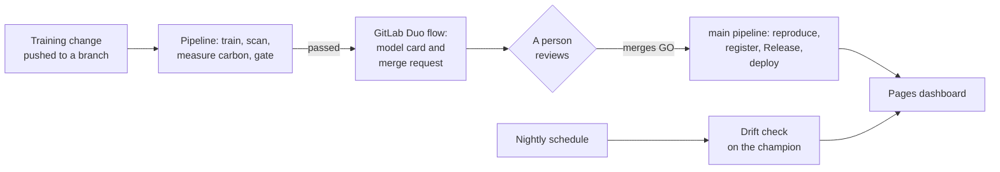

# ModelGate

Every model gets a merge request.

ModelGate puts a retrained model through the same review path as code. A training change on a
branch starts a pipeline that trains a challenger, tests it on a fixed holdout overall and per
customer segment, scans it, measures its carbon cost, and computes a GO, NEEDS REVIEW or NO-GO
verdict from published rules. A GitLab Duo custom flow then writes the model card and opens a
merge request titled by the verdict. A person merges. Merging a GO candidate promotes it: the
`main` pipeline releases it, records a production deployment and updates the dashboard.

It is for small ML teams on GitLab that do not run a separate MLOps platform. It needs no
CI/CD variables and no personal tokens.

## See it on GitLab

| What | Where |
| --- | --- |
| Branch and `main` pipelines: training, gate, unit tests, SAST, secret detection | [Pipelines](https://gitlab.com/gitlab-ai-hackathon/transcend-october-2026/43712399/showcase/-/pipelines) |
| The merge requests the flow opened, one per verdict | [Merge requests](https://gitlab.com/gitlab-ai-hackathon/transcend-october-2026/43712399/showcase/-/merge_requests?scope=all&state=all) |
| Promoted model versions, each with its model card | [Releases](https://gitlab.com/gitlab-ai-hackathon/transcend-october-2026/43712399/showcase/-/releases) |
| Production deployments, and the link to the dashboard | [Environments](https://gitlab.com/gitlab-ai-hackathon/transcend-october-2026/43712399/showcase/-/environments) |
| Registered candidates and versions | [Package registry](https://gitlab.com/gitlab-ai-hackathon/transcend-october-2026/43712399/showcase/-/packages), [Model registry](https://gitlab.com/gitlab-ai-hackathon/transcend-october-2026/43712399/showcase/-/ml/models) |
| Model cards and decision records | [models/cards](models/cards), [models/decisions](models/decisions) |

## How it works



1. A person pushes a training change to a branch.
2. The pipeline ([.gitlab-ci.yml](.gitlab-ci.yml)) trains, scans, measures and gates the
   challenger, and registers it as `<version>-rc.<pipeline>`.
3. The passed pipeline triggers the ModelGate flow
   ([.gitlab/duo/flows/modelgate.yaml](.gitlab/duo/flows/modelgate.yaml)). It writes the model
   card and the decision record to the branch and opens or updates the merge request, titled
   and labelled by the verdict. On GO and NEEDS REVIEW it requests a review from the people in
   [config/review.yaml](config/review.yaml).
4. A person merges. Merging a GO candidate makes it the champion in `models/champion.json`.
5. The `main` pipeline checks that it reproduces the approved candidate exactly, registers the
   final version, creates the Release `model-v<version>` with the model card, records a
   `production` deployment and republishes the Pages dashboard. The flow then posts
   "Promotion complete" on the merged merge request.

A nightly schedule scores a drifted batch with the champion, and the dashboard charts the
result. A second flow, ModelGate Ask
([.gitlab/duo/flows/modelgate-ask.yaml](.gitlab/duo/flows/modelgate-ask.yaml)), answers
questions such as "what would make this GO?" when someone mentions it on a merge request.

## The gate

The rules and their thresholds are in [config/thresholds.yaml](config/thresholds.yaml).

| Rule | Passes when | If it fails |
| --- | --- | --- |
| no_regression | challenger AUC >= champion AUC - 0.005 | NO-GO |
| min_absolute_auc | challenger AUC >= 0.80 | NO-GO |
| slice_gap | best and worst segment AUC within 0.05 | NEEDS REVIEW |
| calibration | challenger Brier <= champion Brier + 0.01 | NO-GO |
| scan_clean | picklescan finds nothing unexpected and pip-audit no HIGH or CRITICAL advisory; a scan that did not run fails | NO-GO |
| carbon_efficiency | gCO2e per 0.01 AUC gained <= 2.0, checked only when AUC improves | NEEDS REVIEW |

GO means every rule passed. On the first run there is no champion; the rules that need one
are marked `bootstrap` and the proposed version is 0.1.0. Version bumps are computed too:
major for a new model family or output schema, minor for a changed feature list, patch for
anything else.

## What the agent decides, and what it cannot do

- **It decides** which pipeline it is looking at, stops on pipelines that need no merge
  request, and creates or updates the merge request.
- **It writes** two blocks of text only: the card's Analysis and the merge request's
  three-line Summary. Code renders every table and figure in the card, and every file and git
  operation goes through `python -m modelgate.flow`.
- **It cannot** change the verdict. The commit step rejects its text if it edited anything
  outside its two blocks, used a number that is not in the card or the decision record, or
  called a failed rule passed. Its instructions forbid merging, approving, pushing to `main`
  and changing settings, and it runs with the Developer role.

[AGENTS.md](AGENTS.md) holds the agent's rules.

## Carbon

Each candidate's evaluation runs under CodeCarbon, and the energy is converted to a Software
Carbon Intensity figure in gCO2e per evaluated candidate. [docs/SCI.md](docs/SCI.md) gives the
method and every assumption with its source. The `carbon_efficiency` rule flags retrains that
cost carbon for a noise-level gain, and branch pipelines train only when `config/`,
`modelgate/` or `requirements.txt` changed (or the commit message says `[train]`), so a
docs-only push costs no training run. The
dashboard splits the carbon spent by verdict and shows the total spent to reach each version.

## Stage map

[docs/STAGES.md](docs/STAGES.md) describes each stage in detail.

| Stage | What ModelGate does | Where to see it |
| --- | --- | --- |
| Create | The flow writes the card and opens one merge request per branch, titled by the verdict | [Merge requests](https://gitlab.com/gitlab-ai-hackathon/transcend-october-2026/43712399/showcase/-/merge_requests?scope=all&state=all) |
| Verify | Training, holdout evaluation per segment, the six rules, unit tests | [Pipelines](https://gitlab.com/gitlab-ai-hackathon/transcend-october-2026/43712399/showcase/-/pipelines) |
| Secure | picklescan on the model file, pip-audit on the lock, SAST, secret detection | [Pipelines](https://gitlab.com/gitlab-ai-hackathon/transcend-october-2026/43712399/showcase/-/pipelines) |
| Package | Each candidate and each promoted version is registered | [Package registry](https://gitlab.com/gitlab-ai-hackathon/transcend-october-2026/43712399/showcase/-/packages) |
| Release | A merged GO candidate is reproduced on `main` and released with its card | [Releases](https://gitlab.com/gitlab-ai-hackathon/transcend-october-2026/43712399/showcase/-/releases) |
| Configure | The `production` environment records each promoted version | [Environments](https://gitlab.com/gitlab-ai-hackathon/transcend-october-2026/43712399/showcase/-/environments) |
| Monitor | A nightly drift check on the champion, charted on the dashboard | [Scheduled pipelines](https://gitlab.com/gitlab-ai-hackathon/transcend-october-2026/43712399/showcase/-/pipelines?source=schedule) |
| Govern | A decision record per candidate, review requests, CODEOWNERS, a person merges | [models/decisions](models/decisions), [.gitlab/CODEOWNERS](.gitlab/CODEOWNERS) |

## Run locally

Python 3.11 or 3.12, git, and network access for pip-audit. Install the lock into a fresh
virtual environment, and run pip as `python -m pip`, because the lock pins pip itself.

```bash
python -m pip install -r requirements.txt
```

```bash
python -m modelgate reports
```

```bash
python -m pytest
```

`python -m modelgate reports` is what CI's `train_evaluate` job runs. It generates the
synthetic data, trains, scans, evaluates under CodeCarbon, and writes `metrics.json`,
`scan.json`, `sci.json` and `gate_report.json` to `reports/`. It takes about 12 seconds.

The demo scenarios change the feature list in `config/train.yaml`. Their verdicts assume the
0.1.0 baseline is the champion, and `tests/test_scenarios.py` checks them end to end.

| Command | Change | Verdict |
| --- | --- | --- |
| `python -m modelgate scenario good` | adds `txn_velocity` | GO, AUC +0.034, minor bump |
| `python -m modelgate scenario bad` | swaps `region_score` (segment C only) for `txn_velocity` | NEEDS REVIEW: AUC +0.016, segment C AUC -0.136 |
| `python -m modelgate scenario bad-auc` | drops `late_payments` | NO-GO: AUC -0.032, Brier +0.013 |
| `python -m modelgate scenario baseline` | restores the baseline | |

The flow's steps also run by hand: see `python -m modelgate.flow --help`.

## Set up on GitLab

[docs/SETUP.md](docs/SETUP.md) has every step with the exact UI paths. In short:

1. Push the repository to a public GitLab project. Keep the merge method on "Merge commit".
2. Create the flow under **AI > Flows** from `.gitlab/duo/flows/modelgate.yaml`, enable it for
   the project, and add a **Pipeline events > Passed** trigger. This needs Maintainer or Owner.
3. Push an empty commit whose message contains `[train]` on a new branch. The flow opens
   **GO: promote model 0.1.0**. Merging it makes the first champion, and the `main` pipeline
   releases it.
4. Add the `Nightly drift check` schedule on `main`, and run the demo scenarios on their own
   branches.

To put the same gate on your own model, see [docs/INSTALL.md](docs/INSTALL.md).

## Repository

| Path | What it is |
| --- | --- |
| [modelgate/](modelgate) | data, training, evaluation, gate, card, flow helper, promotion, drift, dashboard |
| [config/](config) | the gate rules, training config, SCI constants, reviewers |
| [.gitlab-ci.yml](.gitlab-ci.yml) | the pipeline |
| [.gitlab/duo/](.gitlab/duo) | the two flows and their runtime configuration |
| [AGENTS.md](AGENTS.md) | the agent's rules |
| [docs/](docs) | setup, install, the carbon method, the lifecycle stages |
| [STATUS.md](STATUS.md) | what is implemented and what has been verified |

All data is synthetic, generated from a fixed seed by [modelgate/data.py](modelgate/data.py).
Nothing is downloaded and no row describes a real person.

## License

MIT. See [LICENSE](LICENSE).
